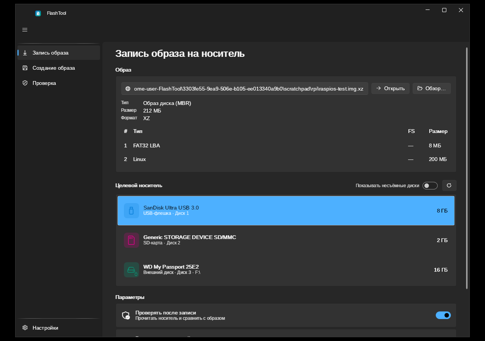
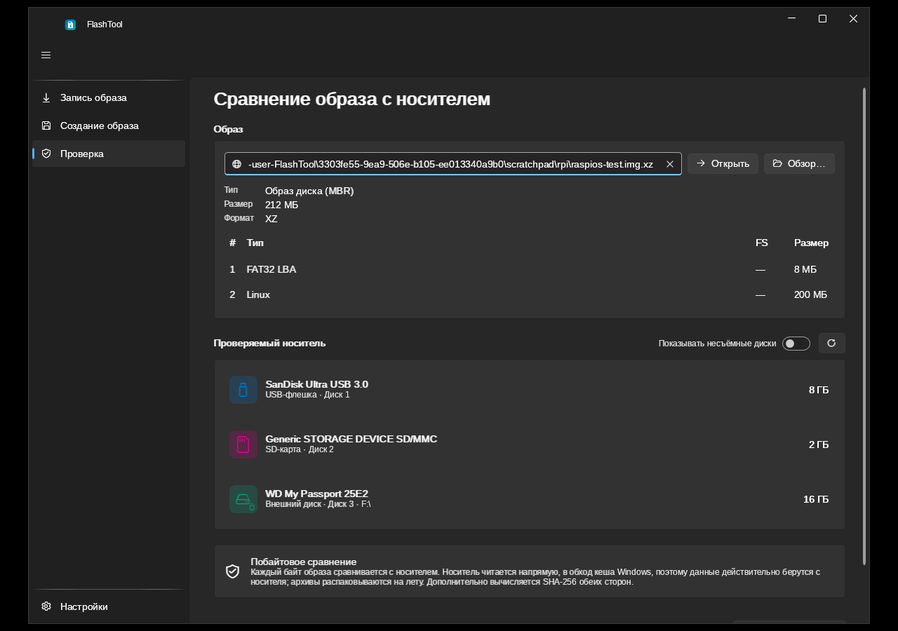

# FlashTool

Программа для записи образов на SD-карты, USB-флешки и диски и для создания образов с них.
WPF (.NET 8 и .NET 10), стиль Fluent на библиотеке [WPF-UI](https://github.com/lepoco/wpfui).
Идея — как у [WinFLASHTool](https://github.com/sysprogs/WinFLASHTool) и Win32 Disk Imager, но с архивами «на лету», загрузкой из интернета и проверкой.

FlashTool работает с носителем **посекторно**, а не копирует отдельные файлы: вместе с данными
записываются таблица разделов, загрузочные структуры и файловые системы исходного образа.
Это удобно для подготовки SD-карт для Raspberry Pi и других одноплатных компьютеров,
восстановления носителя из резервной копии и проверки записанного образа.

Три основные страницы приложения:

* **Запись образа** — локальный файл, образ внутри архива или прямая HTTP(S)-ссылка → носитель.
* **Создание образа** — носитель → обычный `.img` или сжатый архив.
* **Проверка** — сравнение содержимого образа с носителем без записи на него.

> **Внимание:** запись перезаписывает данные и разметку выбранного носителя. Перед запуском
> сохраните важные файлы и проверьте модель, номер диска и ёмкость. Отмена записи не возвращает
> прежние данные. Защита системного диска не заменяет внимательного выбора устройства.

## Скриншоты

### Запись образа на носитель

Выбор образа, просмотр его разделов, список устройств и параметр проверки после записи.



### Сравнение образа с носителем

Отдельная страница для выбора эталонного образа и проверяемого устройства.
На скриншоте показана подготовка к сравнению, а не результат завершённой проверки.



## Требования и запуск

* Для графического приложения нужна **Windows**; автономная сборка в репозитории настроена на **x64**.
* Программа запрашивает права администратора для прямого доступа к физическим дискам.
* Автономный `FlashTool.exe` включает среду .NET; устанавливать .NET отдельно не требуется.
* Для обычной сборки нужен **.NET Desktop Runtime** соответствующей версии (.NET 8 или .NET 10).
  Артефакт `FlashTool-win-x64` из текущего workflow рассчитан на **.NET 10**.
* При создании образа на диске назначения должно хватать свободного места. Для несжатого образа
  ориентируйтесь на объём чтения, показанный в приложении; степень сжатия заранее не гарантируется.
  Файловая система назначения должна поддерживать нужный размер файла (у FAT32 предел — менее 4 ГиБ).

Готовые сборки можно получить на вкладке [Actions](https://github.com/alexsys87/FlashTool/actions):
откройте успешный запуск `build` и скачайте артефакт из раздела **Artifacts**
(для скачивания может потребоваться вход в GitHub).

| Артефакт | Что внутри | Как запустить |
|---|---|---|
| `FlashTool-win-x64-standalone` | Автономный `FlashTool.exe` | Распаковать ZIP и запустить exe |
| `FlashTool-win-x64` | Приложение и сопутствующие файлы, без среды .NET | Распаковать весь ZIP в одну папку, установить .NET 10 Desktop Runtime и запустить `FlashTool.exe` |

## Как пользоваться

### Записать образ

1. Подключите SD-карту, USB-флешку или внешний диск и откройте **«Запись образа»**.
2. Нажмите **«Обзор…»** для выбора файла либо вставьте путь/прямую HTTP(S)-ссылку
   в поле **«Образ»** и нажмите **«Открыть»**. Ссылка должна вести к файлу, а не к странице скачивания.
3. Если архив содержит несколько файлов, выберите нужный образ. Проверьте распознанный тип,
   размер и таблицу разделов.
4. Выберите целевой носитель по модели, номеру и ёмкости. Не включайте показ несъёмных дисков без необходимости.
5. Рекомендуется оставить включённой **«Проверять после записи»**. Параметр расширения последнего
   раздела используйте, если хотите занять свободное место более ёмкого носителя; ограничения приведены ниже.
6. Запустите запись и подтвердите перезапись выбранного устройства. Дождитесь завершения записи,
   проверки и финальных изменений разметки; не отключайте носитель во время операции.

**Важно:** на носитель должен помещаться **распакованный образ**, а не только файл архива.
Архив в несколько сотен мегабайт может содержать образ на несколько гигабайт.
Если размер заранее неизвестен, ошибка нехватки места может обнаружиться уже во время записи.

### Создать резервный образ

1. Откройте **«Создание образа»** и выберите исходный носитель.
2. Укажите путь сохранения на **другом носителе**, формат и, для архива, уровень сжатия.
3. Выберите чтение всего носителя либо режим **«только размеченные разделы»**.
4. Оставьте включённой проверку созданного файла и запустите операцию.

Режим «только размеченные разделы» читает непрерывный диапазон от начала диска до конца
последнего распознанного раздела. Это **не** копирование только занятых файлов:
свободные блоки внутри разделов и промежутки между ними также попадают в образ.
Если конец разметки определить не удалось, читается весь носитель.
Для полной посекторной копии, включая хвост диска, выберите чтение всего носителя.

Проверка после создания заново открывает полученный файл, распаковывает его при необходимости
и сравнивает с хешами блоков, прочитанных при копировании. Она не выполняет второй проход по исходному диску.
При ошибке или отмене программа пытается удалить незавершённый файл; это не средство восстановления
данных с повреждённых носителей с пропуском нечитаемых секторов.

### Проверить образ и носитель

1. Откройте **«Проверка»**, загрузите эталонный файл, архив или прямую ссылку.
2. Выберите образ внутри архива и проверяемый носитель.
3. Запустите сравнение и дождитесь отчёта: SHA-256 обеих сторон и, при несовпадении,
   смещения, длины и расположение отличающихся участков.

Сравнивается диапазон **длины образа**, а не вся ёмкость более крупного носителя.
В интерфейсе показываются первые 500 участков отличий и счётчик остальных.
Если после записи расширялся раздел, изменялись метаданные файловой системы или Windows/другая ОС
уже записала данные на носитель, побайтовое совпадение с исходным образом не гарантируется.
Автоматическая проверка после записи выполняется **до** финальных изменений разметки.

## Форматы образов и архивов

| Формат | Запись / отдельная проверка | Создание образа | Особенности |
|---|---|---|---|
| Raw (`.img`, `.iso` и другие несжатые образы) | Да | `.img` | Копирование исходных байтов; пригодность ISO для загрузки с USB зависит от самого образа |
| XZ (`.xz`, например `.img.xz`) | Да | Да | Потоковая распаковка и сжатие; требуется доступная liblzma |
| GZip (`.gz`, например `.img.gz`) | Да | Да | Потоковая обработка одного образа |
| ZIP (`.zip`) | Да | Да | Можно выбрать файл внутри архива; для HTTP(S) требуется поддержка Range |
| 7-Zip (`.7z`) | Да | Да | Можно выбрать файл внутри архива; требуется 7z.dll, для HTTP(S) — Range |

Для записи архив распаковывается прямо в поток, без промежуточного несжатого файла.
Создание архива выполняется сразу при чтении носителя. Доступность формата зависит от его
обработчика и необходимых библиотек; автономная x64-сборка включает liblzma и 7z.dll.
Программа не превращает произвольный ISO в загрузочную USB-флешку и не создаёт файловый ISO из папок.

## Возможности

| Функция | Состояние |
|---|---|
| Fluent-интерфейс (WPF-UI), светлая/тёмная тема, по умолчанию следует теме Windows | ✅ |
| Русский/английский, по умолчанию по языку Windows, переключение без перезапуска | ✅ |
| Разные иконки: USB-флешка, SD-карта, внешний диск, внутренний диск | ✅ |
| Несъёмные диски скрыты по умолчанию (переключатель); системный диск записать нельзя | ✅ |
| Автообновление списка при подключении/отключении устройств | ✅ |
| Запись образа (raw, .img, .iso) | ✅ |
| Создание образа: весь носитель или «только размеченные разделы» (как в Win32 Disk Imager) | ✅ |
| Чтение и запись архивов **xz, zip, 7z, gz** потоково, без распаковки во временные файлы | ✅ |
| Создание архива сразу при чтении носителя (сжатие на лету в файл) | ✅ |
| Проверка (верификация) после записи и после создания образа, в т.ч. архивов; отключается | ✅ |
| Повторы при сбоях чтения/записи (бэд-сектор, таймаут): 5 автоматических попыток с того же места, затем окно «Повторить / Отменить» | ✅ |
| Сохранение выбранного: размер и положение окна, страница, образы, файлы в архивах, носители, путь сохранения | ✅ |
| Страница «Проверка»: побайтовое сравнение образа (файл, архив, ссылка) с носителем, SHA-256 обеих сторон, список отличающихся участков по разделам | ✅ |
| Распознавание образа по содержимому (MBR, GPT, ISO 9660/hybrid, ФС без таблицы) | ✅ |
| Несколько образов в архиве — выбор нужного | ✅ |
| Запись по ссылке http(s) прямо на носитель, с докачкой после обрыва связи | ✅ |
| Перенос резервной GPT в конец носителя, расширение последнего раздела (MBR/GPT) | ✅ |
| Расширение файловой системы ext2/ext3/ext4 (собственная реализация, без внешних утилит) | ✅ |
| Расширение NTFS (средствами Windows, FSCTL_EXTEND_VOLUME) | ✅ |
| Автономная сборка: один `FlashTool.exe`, установленный .NET не нужен | ✅ |
| FAT32/exFAT — расширяется только раздел, файловая система остаётся прежнего размера | ⚠️ |

## Структура решения

```
src/
  FlashTool.Core/              платформенно-независимая логика (net8.0; net10.0)
    Containers/                raw, zip, xz (liblzma, многопоточно), gz, 7z (7z.dll) + реестр форматов
    Sources/                   локальный файл, HTTP (Range, докачка)
    Imaging/                   распознавание образов (ImageInspector)
    Partitioning/              MBR, GPT, определение ФС, правка таблиц разделов
    Operations/                запись, создание образа, конвейер, верификация, прогресс
    Devices/                   модель устройства, классификация (флешка / SD / диск)
  FlashTool.Platform.Windows/  \\.\PhysicalDriveN, IOCTL, блокировка и размонтирование томов
  FlashTool.App/               WPF-приложение (MVVM, CommunityToolkit.Mvvm, DI)
tests/
  FlashTool.Core.Tests/        xUnit: таблицы разделов, сквозные запись/чтение, HTTP, отмена, ошибки
```

Как это работает:

* **Конвейер.** Поток-производитель читает и распаковывает (или скачивает), поток-потребитель хеширует и пишет;
  буферы выровнены для небуферизованного ввода-вывода.
* **Проверка.** Во время копирования для каждого блока в 4 МБ запоминается хеш XxHash3. Затем носитель
  (или созданный архив, распакованный заново) читается и сравнивается поблочно. Повторно скачивать или
  распаковывать исходник не нужно, и видно смещение первого испорченного блока.
* **Страница «Проверка»** сравнивает каждый байт: образ распаковывается на лету, носитель читается
  без кеша Windows (FILE_FLAG_NO_BUFFERING), обе стороны хешируются SHA-256. Отличия собираются
  в участки и привязываются к таблице разделов или к разделу. Если после записи раздел расширялся,
  отличия в таблице разделов и в метаданных его файловой системы ожидаемы.
* **Сбои носителя.** Все обращения к устройству идут через `ResilientBlockDevice`: неудачный запрос
  повторяется с того же смещения (5 попыток, пауза 0,5→4 с), затем пользователь выбирает «Повторить»
  или «Отменить операцию». На Windows сторожевой таймер прерывает зависший запрос через
  `CancelSynchronousIo` (60 с без ответа считаются таймаутом и тоже повторяются), а «Отмена»
  прерывает зависший запрос сразу.
* **Безопасная запись.** Тома носителя блокируются и размонтируются; первые 4 МБ сначала затираются,
  а настоящие записываются последними, чтобы Windows не смонтировала наполовину записанные разделы.
* **Архивы.** zip и 7z требуют произвольного доступа (оглавление в конце файла), поэтому по сети они работают
  только с серверами, поддерживающими HTTP Range. xz и gz читаются строго последовательно с любого сервера.
* **Новые форматы** добавляются реализацией `IContainerHandler` и регистрацией в `ContainerRegistry`.
* **Расширение ext2/3/4** (`FileSystems/Ext4/Ext4Grow.cs`) работает офлайн, как `resize2fs`:
  дорасширяет последнюю группу блоков, добавляет новые группы (их битовые карты и таблица inode
  лежат внутри группы), растит таблицу дескрипторов за счёт зарезервированных GDT-блоков (resize inode),
  пересчитывает контрольные суммы (crc32c metadata_csum или crc16 gdt_csum) и обновляет все резервные копии
  суперблока. Неподдерживаемые раскладки (meta_bg, bigalloc, sparse_super2, неочищенный журнал)
  не трогаются. Тесты создают ФС настоящим `mke2fs` и проверяют результат `e2fsck`.
* **Расширение NTFS** выполняется после того, как Windows смонтирует том (`NtfsVolumeExtender`).

## Сборка из исходников

Нужен стабильный **.NET SDK 10**: `global.json` задаёт `10.0.100` с переходом на более свежий
feature band версии 10.0. Для сборки и запуска тестов обоих целевых фреймворков установите
также SDK 8 (как в GitHub Actions); для запуска варианта WPF на .NET 8 нужна его Desktop Runtime.
Команды выполняются из корня репозитория. В PowerShell на Windows:

```powershell
git clone https://github.com/alexsys87/FlashTool.git
cd FlashTool
dotnet --list-sdks
dotnet build FlashTool.sln -c Release
dotnet test tests/FlashTool.Core.Tests -c Release --no-build
dotnet run --project src/FlashTool.App -f net10.0-windows
```

Вариант приложения на .NET 8:

```powershell
dotnet run --project src/FlashTool.App -f net8.0-windows
```

Автономный exe (без установленного .NET; liblzma и 7z.dll встроены и при первом запуске
распаковываются в `%LOCALAPPDATA%\FlashTool\native`):

```powershell
dotnet publish src/FlashTool.App -f net10.0-windows -p:PublishProfile=win-x64-standalone
```

Результат: `src\FlashTool.App\bin\publish\win-x64-standalone\FlashTool.exe`.
Профиль задаёт Release, `win-x64`, автономную среду .NET и упаковку в один файл.

Обычная сборка без встроенной среды .NET (вся папка нужна для распространения):

```powershell
dotnet publish src/FlashTool.App -c Release -f net10.0-windows -r win-x64 --self-contained false -o publish/FlashTool
```

Workflow [`.github/workflows/build.yml`](.github/workflows/build.yml) на Windows собирает решение
и запускает тесты под .NET 8 и .NET 10, затем публикует два x64-артефакта на .NET 10.
Отдельного артефакта на .NET 8 в текущем workflow нет.

## Настройки и диагностика

Программа запрашивает права администратора (без них нет доступа к `\\.\PhysicalDriveN`).

* Путь к образу можно передать аргументом: `FlashTool.exe raspios.img.xz` (или перетащить файл на exe).
* Необработанные ошибки записываются в `%LOCALAPPDATA%\FlashTool\error.log`.
* Все настройки и выбор пользователя хранятся в `%LOCALAPPDATA%\FlashTool\settings.json`.
* В отладочной сборке `FLASHTOOL_DEMO_FAULT=N` имитирует N сбоев записи демо-флешки на 64 МБ (проверка повторов).
* В отладочной сборке переменная `FLASHTOOL_DEMO=1` подменяет реальные диски виртуальными
  (файлы в `%TEMP%\FlashToolDemo`) — удобно для проверки интерфейса и полного цикла без риска.
Библиотеки ядра и тесты собираются и запускаются также на Linux; графическое приложение
и прямой доступ к устройствам через Windows API там не работают. Для кросс-компиляции WPF
потребуется `-p:EnableWindowsTargeting=true`; запускать готовый интерфейс нужно на Windows.

### Частые вопросы

* **Носитель не виден.** Проверьте подключение и наличие карты в кардридере, обновите список.
  Несъёмные диски скрыты по умолчанию; включайте их показ только при необходимости.
* **Образ не распознан.** Проверьте, что выбран сам образ, а не HTML-страница, файл контрольных сумм
  или другой файл из архива. Запись нераспознанного содержимого требует отдельного подтверждения.
* **ZIP/7z по ссылке не открывается.** Сервер должен поддерживать произвольное чтение через HTTP Range.
  Попробуйте сначала скачать архив локально; XZ/GZip читаются последовательно.
* **Windows предлагает отформатировать носитель после записи Linux-образа.** Не соглашайтесь,
  если хотите сохранить образ: Windows не обязана распознавать его Linux-разделы.
* **Не увеличилась доступная ёмкость.** Увеличение раздела и файловой системы — разные операции.
  FAT32/exFAT автоматически не растут; для других ФС проверьте итоговое сообщение операции.
* **Возникают ошибки ввода-вывода.** Проверьте кабель, порт, кардридер и сам носитель.
  Повторы не исправляют физически повреждённую память; после исчерпания попыток можно повторить запрос
  или отменить операцию. Не считайте частично записанный носитель готовым к использованию.

## Ограничения

* FAT32/exFAT не расширяются (Windows этого не умеет, а перенос данных FAT рискован) — растёт только раздел.
* Расширение логического раздела MBR (внутри extended) пока не поддерживается.
* Образы ISO не изменяются после записи (без переноса GPT и расширения), потому что гибридные ISO
  содержат намеренно перекрывающиеся структуры.
* Для 7z нужен 7z.dll (x86/x64 поставляется через пакет 7z.Libs); на ARM64 формат 7z недоступен.
