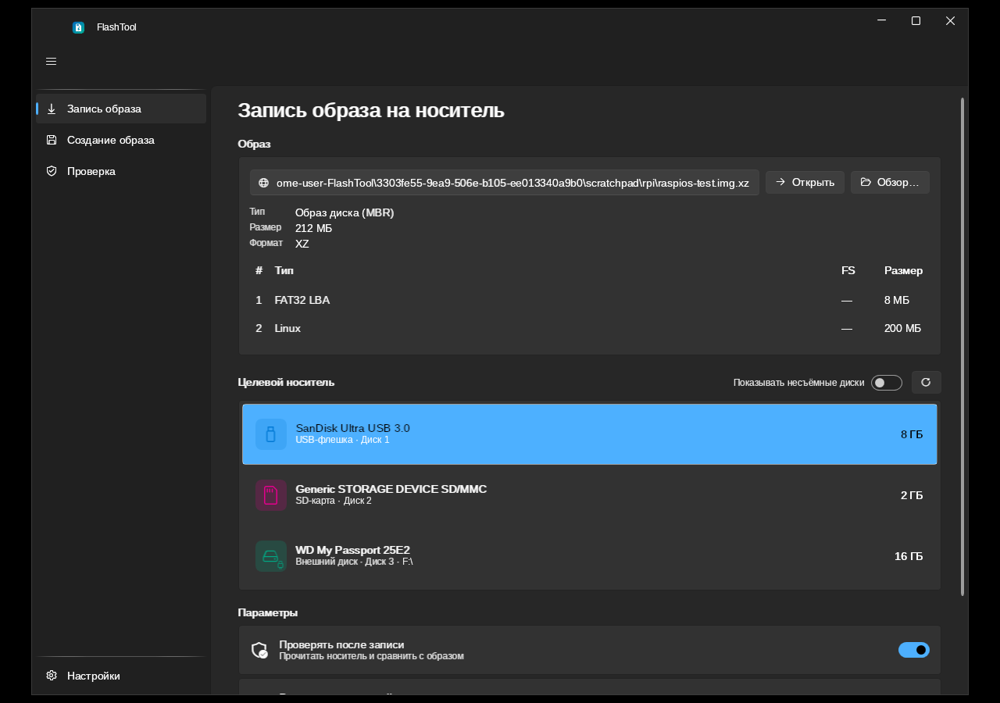
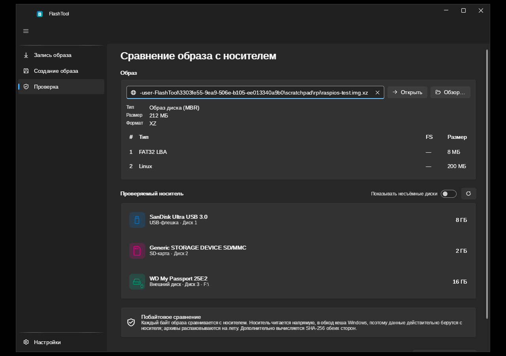

# FlashTool

Программа для записи образов на SD-карты, USB-флешки и диски и для создания образов с них.
WPF (.NET 8 и .NET 10), стиль Fluent на библиотеке [WPF-UI](https://github.com/lepoco/wpfui).
Идея — как у [WinFLASHTool](https://github.com/sysprogs/WinFLASHTool) и Win32 Disk Imager, но с архивами «на лету», загрузкой из интернета и проверкой.

FlashTool работает с носителем **посекторно**, а не копирует отдельные файлы: вместе с данными
записываются таблица разделов, загрузочные структуры и файловые системы исходного образа.
Это удобно для подготовки SD-карт для Raspberry Pi и других одноплатных компьютеров,
восстановления носителя из резервной копии и проверки записанного образа.

Три основные страницы приложения:

* **Запись образа** — локальный файл, образ внутри архива или прямая HTTP(S)-ссылка → носитель.
* **Создание образа** — носитель → обычный `.img` или сжатый архив.
* **Проверка** — сравнение содержимого образа с носителем без записи на него.

Дополнительно в настройках можно включить страницу **«Очистка»** — стирание носителя
и создание на нём новой файловой системы FAT32 или exFAT (по умолчанию страница скрыта).

> **Внимание:** запись перезаписывает данные и разметку выбранного носителя. Перед запуском
> сохраните важные файлы и проверьте модель, номер диска и ёмкость. Отмена записи не возвращает
> прежние данные. Защита системного диска не заменяет внимательного выбора устройства.

## Скриншоты

### Запись образа на носитель

Выбор образа, просмотр его разделов, список устройств и параметр проверки после записи.



### Сравнение образа с носителем

Отдельная страница для выбора эталонного образа и проверяемого устройства.
На скриншоте показана подготовка к сравнению, а не результат завершённой проверки.



## Требования и запуск

* Для графического приложения нужна **Windows**; автономная сборка в репозитории настроена на **x64**.
* Программа запрашивает права администратора для прямого доступа к физическим дискам.
* Автономный `FlashTool.exe` включает среду .NET; устанавливать .NET отдельно не требуется.
* Для обычной сборки нужен **.NET Desktop Runtime** соответствующей версии (.NET 8 или .NET 10).
  Версия среды указана в имени артефакта: `net8` или `net10`. MSI включает автономную сборку и не требует установки .NET.
* При создании образа на диске назначения должно хватать свободного места. Для несжатого образа
  ориентируйтесь на объём чтения, показанный в приложении; степень сжатия заранее не гарантируется.
  Файловая система назначения должна поддерживать нужный размер файла (у FAT32 предел — менее 4 ГиБ).

Готовые сборки можно получить на вкладке [Actions](https://github.com/alexsys87/FlashTool/actions):
откройте успешный запуск `build` и скачайте артефакт из раздела **Artifacts**
(для скачивания может потребоваться вход в GitHub).

| Артефакт | Что внутри | Как запустить |
|---|---|---|
| `FlashTool-net8-win-x64-standalone` / `FlashTool-net10-win-x64-standalone` | Автономный `FlashTool.exe` для .NET 8 / 10 | Распаковать ZIP и запустить exe; установка .NET не нужна |
| `FlashTool-net8-win-x64` / `FlashTool-net10-win-x64` | Приложение и сопутствующие файлы, без среды .NET | Распаковать весь ZIP в одну папку, установить соответствующий .NET Desktop Runtime и запустить `FlashTool.exe` |
| `FlashTool-net8-win-x64-msi` / `FlashTool-net10-win-x64-msi` | MSI-установщик с автономным приложением | Распаковать ZIP и запустить `.msi`; установка .NET не нужна |

MSI устанавливает приложение для всех пользователей в `Program Files\FlashTool-net8` или
`Program Files\FlashTool-net10`, создаёт ярлыки на рабочем столе и в меню «Пуск», а также запись в списке установленных
приложений Windows. Стандартный мастер позволяет выбрать папку установки кнопкой
**Change…** на странице **Destination Folder** (интерфейс установщика — английский).
Установка требует прав администратора; удаление выполняется через
«Установленные приложения». Варианты .NET 8 и .NET 10 можно установить одновременно:
у них разные каталоги, ярлыки и идентификаторы обновления. Настройки приложения при этом
общие (`%LOCALAPPDATA%\FlashTool`) и не удаляются установщиком. MSI и exe не подписаны
цифровой подписью, поэтому Windows может показывать предупреждение о неизвестном издателе.

## Как пользоваться

### Записать образ

1. Подключите SD-карту, USB-флешку или внешний диск и откройте **«Запись образа»**.
2. Нажмите **«Обзор…»** для выбора файла либо вставьте путь/прямую HTTP(S)-ссылку
   в поле **«Образ»** и нажмите **«Открыть»**. Ссылка должна вести к файлу, а не к странице скачивания.
   Файл можно и просто перетащить из Проводника в любое место окна: он откроется на странице
   «Проверка», если она открыта, иначе — на странице «Запись образа».
3. Если архив содержит несколько файлов, выберите нужный образ. Проверьте распознанный тип,
   размер и таблицу разделов.
4. Выберите целевой носитель по модели, номеру и ёмкости. Не включайте показ несъёмных дисков без необходимости.
   Под списком показано, что на носителе сейчас: таблица разделов, файловые системы, метки томов и размеры.
   Те же сведения повторяются в окне подтверждения: это последний шанс заметить, что выбран не тот диск.
5. Если автор образа опубликовал контрольную сумму SHA-256, вставьте её в поле **«Контрольная сумма»**
   (сумма файла как он скачивается, например `.img.xz`, а не распакованного образа). Программа сама ищет
   `<файл>.sha256` или `SHA256SUMS` рядом с файлом или ссылкой и подставляет найденное: проверьте, что оно
   не устарело. Локальный файл проверяется до начала записи, скачиваемый — по ходу загрузки, и таблица
   разделов записывается, только если сумма совпала.
6. Рекомендуется оставить включённой **«Проверять после записи»**. Расширение последнего
   раздела по умолчанию выключено: включите его, если хотите занять свободное место более ёмкого носителя;
   ограничения приведены ниже.
7. **«Извлечь носитель после записи»** (по умолчанию выключено) после успешной записи выполняет
   «Безопасное извлечение устройства»: USB-флешку или кардридер можно сразу отключать, у встроенного
   кардридера карта переводится в состояние «извлечена».
8. Запустите запись и подтвердите перезапись выбранного устройства. Дождитесь завершения записи,
   проверки и финальных изменений разметки; не отключайте носитель во время операции.

**Важно:** на носитель должен помещаться **распакованный образ**, а не только файл архива.
Архив в несколько сотен мегабайт может содержать образ на несколько гигабайт.
Если размер заранее неизвестен, ошибка нехватки места может обнаружиться уже во время записи.

#### Запись только отличий (экспериментально)

В **«Настройки» → «Запись образа»** можно включить **«Записывать только отличия»** (по умолчанию выключено).
Тогда перед записью каждая часть носителя читается и сравнивается с образом блоками по 64 КиБ, и пишутся
только отличающиеся блоки. Отличия, между которыми меньше 256 КиБ совпадающих данных, пишутся одним запросом:
мелкие разрозненные записи медленные и сильнее изнашивают дешёвую флеш-память. Результат — тот же носитель,
что и после полной записи. Это полезно, если одну и ту же карту много раз перепрошивают новыми сборками:
меньше износ, а когда изменилось немного, ещё и быстрее, ведь чтение обычно в разы быстрее записи.

* **Выигрыш зависит от образа.** «Изменилось несколько файлов» не значит «изменилось несколько секторов»:
  в squashfs и в ext4, собранном из каталога, изменение размера одного файла сдвигает всё, что после него.
  Лучше всего это работает, когда меняется один раздел (ядро, boot) или сборки воспроизводимы. Оценить заранее
  можно на странице «Проверка»: сравните новый образ с картой, на которой стоит прошлая прошивка. Доля отличий
  в отчёте и есть доля, которую придётся записать.
* **По времени выгода не гарантирована.** Сравнение читает весь образ, поэтому оно выигрывает, пока отличается
  меньше доли «1 − скорость записи / скорость чтения». Когда в скользящем окне (128 МБ сравнённых данных) отличий
  больше этого порога (но не меньше 50%: каждый совпавший блок всё равно экономит запись), сравнение
  отключается и данные пишутся сразу. Каждый 16-й блок при этом всё равно сравнивается, и если совпадения
  вернулись (например, начался другой раздел), сравнение включается снова.
* **Надёжность та же, что у полной записи.** Первый фрагмент с таблицей разделов по-прежнему сначала обнуляется
  и записывается последним, а проверка после записи читает **всё**, включая пропущенные блоки. Иначе
  поддельная карта, у которой запись в дальний блок портит ближний, уже сравнённый, прошла бы проверку.
  Ошибка чтения при сравнении не прерывает запись: такой фрагмент просто записывается.
* С `.bmap` сравниваются только блоки из его плана записи; дыры по-прежнему не трогаются.
* Скорость в индикаторе считается по реальной работе носителя (чтение для сравнения плюс запись), поэтому
  совпавшие участки её не завышают. В итоге показано, сколько записано и какая доля совпала.

### Создать резервный образ

1. Откройте **«Создание образа»** и выберите исходный носитель.
2. Укажите путь сохранения на **другом носителе**, формат и, для архива, уровень сжатия.
3. Выберите чтение всего носителя либо режим **«только размеченные разделы»**.
4. Оставьте включённой проверку созданного файла.
5. Оставьте включённым **«Сохранить файл контрольной суммы»**: рядом с образом появится `<образ>.sha256`
   (SHA-256 самого файла в формате `sha256sum`, его понимает `sha256sum -c`). При записи этого образа
   обратно программа найдёт файл сама.
6. Запустите операцию.

Режим «только размеченные разделы» читает непрерывный диапазон от начала диска до конца
последнего распознанного раздела. Это **не** копирование только занятых файлов:
свободные блоки внутри разделов и промежутки между ними также попадают в образ.
Если конец разметки определить не удалось, читается весь носитель.
Для полной посекторной копии, включая хвост диска, выберите чтение всего носителя.

#### Быстрое создание: пропуск свободного места ext2/3/4

В **«Настройки → Создание образа»** можно включить **«Пропускать свободное место ext2/3/4»**
(по умолчанию выключено). Тогда свободные блоки файловых систем ext2/3/4 не читаются с носителя,
а записываются в образ нулями: создание идёт быстрее, а xz, gz и zst сжимают нули почти даром.
Свободные блоки берутся из битовых карт самой ФС, включая группы `BLOCK_UNINIT`, у которых
битовой карты на диске нет. Когда режим включён, страница «Создание образа» об этом напоминает,
а итог операции показывает, сколько данных не читалось.

Такой образ — **уже не побайтовая копия** носителя: содержимое свободного места (например, удалённые
файлы) в него не попадает, а сравнение образа с исходным носителем на странице «Проверка» покажет
отличия в этих блоках. Файловая система в образе при этом цела: метаданные, журнал и все занятые
блоки копируются как есть. Режим работает осторожно, и ФС копируется полностью, если:

* она не была корректно отключена, содержит ошибки или её журнал ещё не воспроизведён
  (битовые карты на диске могут быть неактуальны);
* не совпадают контрольные суммы суперблока, дескрипторов групп или битовых карт;
* используются bigalloc или внешний журнал;
* раздел перекрывается с другим (гибридные ISO не затрагиваются вовсе).

Всё остальное — таблица разделов, загрузчик в промежутке перед первым разделом (как в образах Yocto),
FAT, exFAT, NTFS и другие ФС, промежутки между разделами — читается полностью. Свободные участки
короче 256 КиБ тоже читаются: дробить чтение на мелкие запросы дороже, чем прочитать их.

Проверка после создания заново открывает полученный файл, распаковывает его при необходимости
и сравнивает с хешами блоков, прочитанных при копировании. Она не выполняет второй проход по исходному диску.
При ошибке или отмене программа пытается удалить незавершённый файл; это не средство восстановления
данных с повреждённых носителей с пропуском нечитаемых секторов.

### Карты блоков (.bmap)

`.bmap` — XML-файл формата bmaptool: размер образа и список блоков, в которых есть данные, с SHA-256
каждого диапазона. Остальное — дыры (нули), которые не нужно писать. Yocto (`wic`) кладёт его рядом с
образом: `core-image.wic.zst` и `core-image.wic.bmap`. Обе возможности включаются в
**«Настройки → Карты блоков (.bmap)»** и по умолчанию выключены.

**Запись и проверка по .bmap.** Когда настройка включена, программа сама ищет `.bmap` рядом с образом:
сначала `<образ без расширения сжатия>.bmap`, затем `<образ>.bmap`, локально и по HTTP(S). На страницах
«Запись образа» и «Проверка» видно, какой файл найден и сколько в нём данных, а переключатель позволяет
не использовать его для этого образа. Читаются форматы 1.0–2.0 (SHA-1 или SHA-256); собственная
контрольная сумма `.bmap` проверяется, и повреждённый файл не используется.

* На носитель пишутся только размеченные блоки, поэтому запись образа Yocto идёт в разы быстрее.
  Проверка после записи читает только то, что было записано.
* Пока образ распаковывается, он сверяется с `.bmap`: каждый диапазон — со своей SHA-256, а дыры должны
  содержать нули (bmaptool строит карту по дырам разреженного файла). Если `.bmap` от другой сборки, запись
  прерывается до того, как на носитель попадёт первый фрагмент с таблицей разделов. `.bmap` для образа другого
  размера отвергается сразу, ещё до записи. Для `.gz` и `.bz2` размер образа берётся из `.bmap`, поэтому заранее
  работают проверка «образ больше носителя» и точный прогресс.
* **Отличие от bmaptool.** bmaptool пишет только размеченные блоки, а в дырах на носителе остаётся то, что было
  раньше. Внутри файловой системы это безвредно, но не за её пределами. В сырой области перед первым разделом
  могло лежать окружение U-Boot от прошлой прошивки. В разделе, который образ оставляет пустым (например, второй
  раздел схемы A/B), могла остаться старая ФС, и система её найдёт. Поэтому FlashTool, кроме данных, всегда пишет
  из образа всё вне разделов (начало диска, промежутки, хвост образа) и первый и последний мегабайт каждого
  раздела, где лежат сигнатуры файловых систем и RAID. Это единицы мегабайт на образ. Для ISO и
  нераспознанных образов `.bmap` не сокращает запись.
* Страница «Проверка» сравнивает только размеченные блоки, как их пишет bmaptool, так что носитель, записанный
  bmaptool, тоже проходит проверку. SHA-256 в отчёте в этом случае считаются по этим блокам.

**Создание .bmap вместе с образом.** При создании образа рядом сохраняется `<образ без расширения сжатия>.bmap`
в формате 2.0 с SHA-256: например, для `backup.img.xz` это `backup.img.bmap`. Если включён пропуск свободного
места ext2/3/4, свободные блоки становятся в нём дырами, и такой образ записывается FlashTool или
`bmaptool copy` в разы быстрее. Без него размечен весь образ, а `.bmap` даёт контрольные суммы распакованных
данных. Старый `.bmap` с тем же именем удаляется перед созданием нового образа.

### Проверить образ и носитель

1. Откройте **«Проверка»**, загрузите эталонный файл, архив или прямую ссылку.
2. Выберите образ внутри архива и проверяемый носитель.
3. Запустите сравнение и дождитесь отчёта: SHA-256 обеих сторон и, при несовпадении,
   смещения, длины и расположение отличающихся участков.

Сравнивается диапазон **длины образа**, а не вся ёмкость более крупного носителя.
В интерфейсе показываются первые 500 участков отличий и счётчик остальных.
Если после записи расширялся раздел, изменялись метаданные файловой системы или Windows/другая ОС
уже записала данные на носитель, побайтовое совпадение с исходным образом не гарантируется.
Автоматическая проверка после записи выполняется **до** финальных изменений разметки.

### Очистить носитель

Страница **«Очистка»** по умолчанию скрыта. Включите её в **«Настройки» → «Очистка носителей»**;
включение требует подтверждения, выключение — нет (во время операции переключатель недоступен).

1. Выберите носитель. Системный диск и защищённые от записи носители недоступны, как и при записи образа.
2. Выберите способ очистки:

   | Способ | Что делает | Время | Старые данные |
   |---|---|---|---|
   | **Быстрая очистка** | Обнуляет таблицы разделов в начале и в конце носителя (MBR, обе копии GPT) и начало каждого старого раздела, где лежат сигнатуры ФС | Секунды | Физически остаются, восстанавливаются специальными программами |
   | **Полное форматирование** | Один раз записывает нули на весь носитель, как полное форматирование Windows | Одна полная запись | Программно не восстанавливаются |
   | **Разрушительное форматирование с проверкой** | Перезаписывает каждый сектор шаблоном и (по умолчанию) читает весь носитель обратно, сравнивая с шаблоном | Полная запись + полное чтение | Не восстанавливаются; заодно проверяется сам носитель |

3. Для разрушительного форматирования выберите шаблон: **случайные данные (рекомендуется)**,
   нули или 0xFF. Случайные данные свои в каждом секторе и зависят от его адреса, поэтому
   проверка чтением находит не только сбойные сектора, но и поддельные карты с завышенной ёмкостью,
   которые «заворачивают» адреса и записывают конец носителя поверх начала. При записи нулей
   такая карта проверку пройдёт: везде прочитаются те же нули.
4. Выберите новую файловую систему, таблицу разделов и метку тома. **«Автоматически»** создаёт
   FAT32 для томов до 32 ГБ и exFAT для бо́льших (как требует стандарт SD-карт); **«Нет»** оставляет
   носитель пустым, без таблицы разделов. MBR совместима с любыми устройствами, но ограничена 2 ТБ.
   Под списком показывается, какой раздел будет создан (размер, кластер).

Многопроходная перезапись (DoD 5220.22-M, Гутман) не предлагается: для флеш-памяти она лишь
изнашивает носитель, а контроллер всё равно сам решает, в какие физические ячейки попадут данные.
Одного прохода достаточно, чтобы данные нельзя было прочитать через интерфейс носителя; гарантированно
уничтожить данные в резервных блоках флеш-памяти может только сам контроллер (или физическое уничтожение).

### Проверить носитель: скорость, сбойные участки, подделка

Страница **«Тест носителя»** по умолчанию скрыта. Включите её в **«Настройки» → «Тест носителей»**.
Защита та же, что у «Очистки» и записи: системный диск и защищённые от записи носители для разрушительных
тестов недоступны, несъёмные диски скрыты, пока их показ не включён. Разрушительный тест начинается только после
подтверждения.

| Тест | Что делает | Данные | Время |
|---|---|---|---|
| **Чтение** | Читает весь носитель в обход кеша Windows: скорость по всему объёму, время каждого запроса, нечитаемые участки | Сохраняются | Одно полное чтение |
| **Запись и проверка** | Заполняет каждый сектор данными, уникальными для его места, и читает весь носитель обратно: подделка и её реальный объём, сбойные и медленные участки, скорость записи и чтения | Уничтожаются | Полная запись + полное чтение |
| **Быстрая проверка на подделку** | Пишет пробы по 1 МБ на степенях двойки и равномерно по объёму, читает их, затем двоичным поиском уточняет, где данные перестают сохраняться | Уничтожаются | Минуты (около 100 МБ записи) |
| **Случайный доступ 4K** | По 10 секунд случайного чтения и записи блоков 4 КиБ по одному запросу (как RND4K Q1T1): IOPS и задержки — то, что важно для системы на карте (классы A1/A2) | Уничтожаются | 20 секунд |

* **Поддельный объём.** Шаблон тот же, что у «Очистки», но он обратим: по любым прочитанным 8 байтам можно
  вычислить, для какого смещения они были записаны. Поэтому тест различает три случая:
  - носитель возвращает данные, записанные по другому адресу, — подделка, «заворачивающая» адреса; реальный объём
    равен наибольшему общему делителю найденных сдвигов;
  - данные теряются от какого-то места до самого конца — подделка, отбрасывающая запись за реальным объёмом;
  - отдельные ошибки — сбойные участки.

  Ошибки не прерывают тест: участок попадает в список, тест идёт дальше.
* **Быстрая проверка** ловит типичные подделки: те, что «обрезают» адрес до степени двойки, и те, что теряют данные
  за реальным объёмом. Подделку с произвольным размером, «заворачивающую» адреса, гарантированно находит только
  полная проверка.
* **График** строится по ходу теста: линии записи и чтения по смещению. Медленные участки (меньше половины медианной
  скорости) затенены, сбойные отмечены внизу, а область за реальным объёмом поддельного носителя закрашена.
  Результаты сохраняются в **CSV** (точки графика, итоги проходов, случайный доступ, все сбойные участки) и **PNG**.
* После разрушительного теста на носителе только тестовые данные, поэтому сразу предлагается создать
  FAT32/exFAT так же, как в «Очистке». Для поддельного носителя это не предлагается: файловая система на
  заявленный объём будет терять данные.
* **Что тест не покажет.** У SD-карт и флешек через USB-кардридер SMART недоступен, поэтому износ ячеек не виден:
  тест сообщает только то, что можно измерить (ошибки, неверные данные, скорость, реальный объём). Один полный
  проход записи для нормальной карты почти не влияет на её ресурс, но и не бесплатен. Скорость зависит от кардридера
  и порта USB.

## Форматы образов и архивов

| Формат | Запись / отдельная проверка | Создание образа | Особенности |
|---|---|---|---|
| Raw (`.img`, `.iso` и другие несжатые образы) | Да | `.img` | Копирование исходных байтов; пригодность ISO для загрузки с USB зависит от самого образа |
| XZ (`.xz`, например `.img.xz`) | Да | Да | Потоковая распаковка и многопоточное сжатие; сжимает чуть хуже 7z, зато это стандартный формат образов Linux; требуется доступная liblzma |
| GZip (`.gz`, например `.img.gz`) | Да | Да | Потоковая обработка одного образа |
| Zstandard (`.zst`, например `.wic.zst`) | Да | Да | Частый формат образов Yocto; быстрая потоковая распаковка, многопоточное сжатие; читаются файлы zstd и pzstd (несколько кадров); размер образа берётся из заголовков кадров, если он там записан |
| bzip2 (`.bz2`, например `.wic.bz2`) | Да | Да | Частый формат образов Yocto; читаются и склеенные потоки pbzip2; распаковка однопоточная и заметно медленнее xz/zstd, сжатие многопоточное (как pbzip2) |
| ZIP (`.zip`) | Да | Да | Можно выбрать файл внутри архива; для HTTP(S) требуется поддержка Range |
| 7-Zip (`.7z`) | Да | Да | Лучшее сжатие; можно выбрать файл внутри архива; требуется 7z.dll, для HTTP(S) — Range |

Для записи архив распаковывается прямо в поток, без промежуточного несжатого файла.
Создание архива выполняется сразу при чтении носителя. Доступность формата зависит от его
обработчика и необходимых библиотек; автономная x64-сборка включает liblzma и 7z.dll, а zst и bz2 реализованы на управляемом коде и доступны всегда.
Программа не превращает произвольный ISO в загрузочную USB-флешку и не создаёт файловый ISO из папок.

## Возможности

| Функция | Состояние |
|---|---|
| Fluent-интерфейс (WPF-UI), светлая/тёмная тема, по умолчанию следует теме Windows | ✅ |
| Русский/английский, по умолчанию по языку Windows, переключение без перезапуска | ✅ |
| Разные иконки: USB-флешка, SD-карта, внешний диск, внутренний диск | ✅ |
| Несъёмные диски скрыты по умолчанию (переключатель); системный диск записать нельзя | ✅ |
| Автообновление списка при подключении/отключении устройств | ✅ |
| Предпросмотр содержимого выбранного устройства: таблица разделов, файловые системы, метки томов (FAT, exFAT, NTFS, ext2/3/4) и размеры; те же сведения в окне подтверждения записи | ✅ |
| Запись образа (raw, .img, .iso) | ✅ |
| Создание образа: весь носитель или «только размеченные разделы» (как в Win32 Disk Imager) | ✅ |
| Быстрое создание образа: свободные блоки ext2/3/4 записываются нулями без чтения (включается в настройках) | ✅ |
| Запись только отличий от того, что уже на носителе (экспериментально, включается в настройках) | ✅ |
| Карты блоков `.bmap` (bmaptool, Yocto): запись и проверка только данных, создание `.bmap` вместе с образом (включается в настройках) | ✅ |
| Чтение и запись архивов **xz, zip, 7z, gz, zst, bz2** потоково, без распаковки во временные файлы | ✅ |
| Создание архива сразу при чтении носителя (сжатие на лету в файл) | ✅ |
| Проверка (верификация) после записи и после создания образа, в т.ч. архивов; отключается | ✅ |
| Повторы при сбоях чтения/записи (бэд-сектор, таймаут): 5 автоматических попыток с того же места, затем окно «Повторить / Отменить» | ✅ |
| Сохранение выбранного: размер и положение окна, страница, образы, файлы в архивах, носители, путь сохранения | ✅ |
| Страница «Тест носителя»: чтение без разрушения, запись с проверкой и поиском подделки объёма, быстрая проверка на подделку, случайный доступ 4K, график скорости, CSV и PNG (включается в настройках) | ✅ |
| Страница «Проверка»: побайтовое сравнение образа (файл, архив, ссылка) с носителем, SHA-256 обеих сторон, список отличающихся участков по разделам, отличия показываются сразу по ходу проверки | ✅ |
| Распознавание образа по содержимому (MBR, GPT, ISO 9660/hybrid, ФС без таблицы) | ✅ |
| Несколько образов в архиве — выбор нужного | ✅ |
| Запись по ссылке http(s) прямо на носитель, с докачкой после обрыва связи | ✅ |
| Проверка контрольной суммы SHA-256 файла образа: поле на странице записи, автоподхват `*.sha256` и `SHA256SUMS` рядом с файлом или ссылкой; локальный файл проверяется до записи, скачиваемый — по ходу загрузки, до записи таблицы разделов | ✅ |
| При создании образа рядом сохраняется `<образ>.sha256` (SHA-256, формат `sha256sum`); переключатель на странице создания, по умолчанию включён | ✅ |
| Перенос резервной GPT в конец носителя, расширение последнего раздела (MBR/GPT), включается в параметрах | ✅ |
| Автоматическое безопасное извлечение носителя после записи (отключаемое, по умолчанию выключено) | ✅ |
| Кнопка безопасного извлечения у каждой флешки, SD-карты и внешнего диска в списке устройств (недоступна во время записи, чтения и проверки) | ✅ |
| Носитель освобождается после любой операции (успех, ошибка, отмена), его сразу можно использовать на другой вкладке | ✅ |
| Пока идёт запись, чтение, проверка или очистка, Windows не уходит в сон по таймеру бездействия (экран по-прежнему может гаснуть) | ✅ |
| Расширение файловой системы ext2/ext3/ext4 (собственная реализация, без внешних утилит) | ✅ |
| Расширение NTFS (средствами Windows, FSCTL_EXTEND_VOLUME) | ✅ |
| Автономная сборка: один `FlashTool.exe`, установленный .NET не нужен | ✅ |
| Страница «Очистка» (включается в настройках с подтверждением): быстрая очистка, полное форматирование нулями, разрушительное форматирование шаблоном с проверкой чтением; новая FAT32/exFAT на MBR/GPT (собственная реализация) | ✅ |
| Расширение FAT32 и exFAT вместе с разделом (собственная реализация, с предупреждением о риске перед записью) | ✅ |

## Структура решения

```
src/
  FlashTool.Core/              платформенно-независимая логика (net8.0; net10.0)
    Containers/                raw, zip, xz (liblzma, многопоточно), gz, zst, bz2, 7z (7z.dll) + реестр форматов
    Sources/                   локальный файл, HTTP (Range, докачка)
    Bmap/                      карты блоков .bmap: разбор, поиск, план записи, создание
    Imaging/                   распознавание образов (ImageInspector)
    Partitioning/              MBR, GPT, определение ФС, правка и создание таблиц разделов
    FileSystems/               расширение ext2/3/4, FAT32 и exFAT, свободное место ext2/3/4, создание FAT32 и exFAT
    Operations/                запись, создание образа, очистка, конвейер, верификация, прогресс
    Devices/                   модель устройства, классификация (флешка / SD / диск)
  FlashTool.Platform.Windows/  \\.\PhysicalDriveN, IOCTL, блокировка и размонтирование томов
  FlashTool.App/               WPF-приложение (MVVM, CommunityToolkit.Mvvm, DI)
tests/
  FlashTool.Core.Tests/        xUnit: таблицы разделов, сквозные запись/чтение, HTTP, отмена, ошибки
```

Как это работает:

* **Конвейер.** Поток-производитель читает и распаковывает (или скачивает), поток-потребитель хеширует и пишет;
  буферы выровнены для небуферизованного ввода-вывода.
* **Проверка.** Во время копирования для каждого блока в 4 МБ запоминается хеш XxHash3. Затем носитель
  (или созданный архив, распакованный заново) читается и сравнивается поблочно. Повторно скачивать или
  распаковывать исходник не нужно, и видно смещение первого испорченного блока.
* **Контрольная сумма источника.** Опубликованная сумма относится к самому файлу (`.img.xz`, `.zip`), поэтому
  хешируется исходный, а не распакованный поток. Локальный файл читается один раз до открытия устройства:
  повреждённый файл не доходит до носителя. Скачиваемый хешируется по ходу загрузки (`HashingStreamSource`)
  и сверяется, когда поток дочитан, но до записи первого блока с таблицей разделов: при несовпадении носитель
  остаётся без таблицы разделов. ZIP/7z по ссылке читаются выборочно, их сумму проверить нельзя.
  Сумма с того же сервера, что и образ, ловит повреждение файла, но не подмену.
* **Файл контрольной суммы при создании образа.** После проверки хешируется готовый файл как он лежит на диске
  (архив, а не данные внутри) и рядом сохраняется `<файл>.sha256`. Хеширование входит в отменяемую часть
  операции: отмена, как и везде, удаляет образ. Сбой записи самого `.sha256` образ не отменяет и показывается
  предупреждением. Старый `.sha256` с тем же именем удаляется перед созданием образа, потому что он описывал
  перезаписываемый файл, независимо от переключателя.
* **Страница «Проверка»** сравнивает каждый байт: образ распаковывается на лету, носитель читается
  без кеша Windows (FILE_FLAG_NO_BUFFERING), обе стороны хешируются SHA-256. Отличия собираются
  в участки и привязываются к таблице разделов или к разделу. О первом же отличии сообщается сразу,
  не дожидаясь конца сравнения: таблица участков заполняется по ходу проверки, а при отмене найденные
  отличия остаются на экране. Если после записи раздел расширялся,
  отличия в таблице разделов и в метаданных его файловой системы ожидаемы.
* **Сбои носителя.** Все обращения к устройству идут через `ResilientBlockDevice`: неудачный запрос
  повторяется с того же смещения (5 попыток, пауза 0,5→4 с), затем пользователь выбирает «Повторить»
  или «Отменить операцию». На Windows сторожевой таймер прерывает зависший запрос через
  `CancelSynchronousIo` (60 с без ответа считаются таймаутом и тоже повторяются), а «Отмена»
  прерывает зависший запрос сразу.
* **Безопасная запись.** Тома носителя блокируются и размонтируются; первые 4 МБ сначала затираются,
  а настоящие записываются последними, чтобы Windows не смонтировала наполовину записанные разделы.
* **Предпросмотр устройства.** Выбранное устройство открывается только на чтение, и
  `ImageInspector.InspectDevice` разбирает таблицу разделов и файловые системы так же, как у образа, плюс метки
  томов (`VolumeLabelReader`): из загрузочного сектора (FAT), суперблока (ext2/3/4), записи `$Volume` в MFT (NTFS)
  и записи метки в корневом каталоге (exFAT). Метка FAT, заданная только записью в корневом каталоге, не видна;
  байты метки FAT вне ASCII читаются в OEM-кодировке региона Windows; метки Btrfs, XFS и прочих не показываются.
  Перед подтверждением записи содержимое читается заново, но не дольше 3 секунд: медленное устройство не задерживает
  окно. После записи (в том числе неудачной или отменённой) предпросмотр обновляется, после извлечения скрывается.
* **Сон системы.** Пока выполняется операция, `OperationState` держит `SleepInhibitor`
  (`SetThreadExecutionState` с `ES_CONTINUOUS | ES_SYSTEM_REQUIRED` на отдельном потоке: состояние
  принадлежит потоку, а продолжения async-методов могут выполняться на любом). Запрос снимается
  в `End`, а при падении процесса исчезает сам. Сон, который запросил пользователь, приложение
  запретить не может, а на ноутбуках с Modern Standby при питании от батареи система сама снимает
  такой запрос через несколько минут после таймаута сна.
* **Архивы.** zip и 7z требуют произвольного доступа (оглавление в конце файла), поэтому по сети они работают
  только с серверами, поддерживающими HTTP Range. xz, gz, zst и bz2 читаются строго последовательно с любого сервера.
* **Новые форматы** добавляются реализацией `IContainerHandler` и регистрацией в `ContainerRegistry`.
* **Расширение ext2/3/4** (`FileSystems/Ext4/Ext4Grow.cs`) работает офлайн, как `resize2fs`:
  дорасширяет последнюю группу блоков, добавляет новые группы (их битовые карты и таблица inode
  лежат внутри группы), растит таблицу дескрипторов за счёт зарезервированных GDT-блоков (resize inode),
  пересчитывает контрольные суммы (crc32c metadata_csum или crc16 gdt_csum) и обновляет все резервные копии
  суперблока. Неподдерживаемые раскладки (meta_bg, bigalloc, sparse_super2) и ФС с записанными ошибками
  или отключённые некорректно без журнала не трогаются. Тесты создают ФС настоящим `mke2fs` и проверяют
  результат `e2fsck`.
* **Расширение FAT32 и exFAT** (`FileSystems/Fat/Fat32Grow.cs`, `FileSystems/ExFat/ExFatGrow.cs`) тоже
  работает офлайн. Большему числу кластеров нужна бо́льшая FAT, а сразу за ней начинается область данных,
  поэтому начало области данных сдвигается вперёд на целое число кластеров: данные этих первых кластеров
  копируются в свободное место, а все номера кластеров (цепочки FAT, записи каталогов, указатель корневого
  каталога) уменьшаются на величину сдвига. Размер кластера и положение остальных данных не меняются.
  В exFAT дополнительно заново строится битовая карта (при нехватке места — в новом непрерывном участке),
  таблица верхнего регистра переносится целиком, непрерывные файлы (NoFatChain), потерявшие первые кластеры,
  получают цепочку в FAT, пересчитываются контрольные суммы записей и загрузочной области.
  Сначала всё проверяется и планируется в памяти (обе копии FAT, цепочки, каталоги, суммы, соответствие
  битовой карте), затем копии пишутся только в свободное место, и лишь после этого перезаписываются
  каталоги, FAT и в последнюю очередь загрузочный сектор. Этот последний шаг не атомарен и не отменяется —
  отсюда предупреждение перед записью. Тесты создают FAT32 настоящим `mkfs.fat`, наполняют через mtools и
  проверяют `fsck.fat`; тома exFAT наполняет собственный минимальный писатель тестов, результат проверяется
  независимым чтением дерева и `fsck.exfat`.
* **Журнал ext3/ext4** (`FileSystems/Ext4/Ext4Journal.cs`). Пока ФС смонтирована, ядро держит флаг
  `needs_recovery`, поэтому он есть у любого образа, снятого с работающей системы, и у карты, вынутой без
  выключения. Перед расширением журнал воспроизводится так же, как при монтировании и в `e2fsck`:
  - подтверждённые транзакции переносятся на свои места, кроме блоков, отменённых (revoke) позже;
  - транзакция без коммита или с неверной суммой коммита считается незавершённой и не применяется;
  - журнал помечается пустым, флаг снимается.

  Поддерживаются журналы без контрольных сумм и с суммами v2/v3, 32- и 64-битные, с extents и с картой блоков (ext3).
  Сначала проверяется всё — суммы дескрипторов, отмен, коммитов и каждого блока данных, — и только потом что-то
  пишется: при любом расхождении ФС не меняется. Внешний журнал, fast commit и асинхронный коммит не
  воспроизводятся. Тесты создают в журнале настоящие незавершённые транзакции через `debugfs` и сравнивают
  результат с воспроизведением в e2fsprogs (`debugfs journal_run`, тот же код, что в `e2fsck`) байт в байт.
* **Свободное место ext2/3/4** (`FileSystems/Ext4/Ext4FreeSpace.cs`, `Operations/FreeBlockMap.cs`) только
  читает метаданные: суперблок, таблицу дескрипторов (в том числе раскладку meta_bg) и битовые карты блоков,
  которые при flex_bg читаются пачками. Для групп `BLOCK_UNINIT` занятые блоки вычисляются, как это делает ядро
  (`ext4_init_block_bitmap`): копии суперблока и дескрипторов, плюс битовые карты и таблицы inode любых групп,
  попавшие в эту группу. Всё, что не доказано свободным, считается занятым. Тесты создают ФС настоящим `mke2fs`
  поверх ненулевых данных и требуют, чтобы каждый обнулённый блок был свободным по `dumpe2fs`, а копия
  проходила `e2fsck` и содержала те же файлы.
* **Карты блоков** (`Bmap/`): `BmapFile` разбирает XML без DTD и с ограничением размера, `BmapWritePlan` добавляет
  к размеченным блокам защитные области, `BmapImageCheck` сверяет поток образа с картой, `BmapBuilder` пишет
  формат 2.0. Тесты проверяют совместимость с настоящим `bmaptool` в обе стороны: его `.bmap` для ext4-образа
  записывается FlashTool (`e2fsck` проходит, данные совпадают с копией bmaptool), а `.bmap` FlashTool принимает
  `bmaptool copy` со всеми своими проверками.
* **Расширение NTFS** выполняется после того, как Windows смонтирует том (`NtfsVolumeExtender`).
* **Запись только отличий** (`Operations/DifferentialWriter.cs`) подключается в потребителе конвейера записи
  (и внутри плана `PlannedWriter` при `.bmap`). Чтения для сравнения идут через отдельную обёртку над тем же
  дескриптором с политикой повторов без вопросов пользователю. Порог отказа от сравнения считается по измеренным
  скоростям чтения и записи. Тесты на устройствах в памяти проверяют число и границы записей, отказ и
  возврат сравнения, ошибку чтения, работу внутри плана `.bmap` и то, что полная проверка ловит поддельную карту.
* **Тест носителя** (`Operations/DeviceTestOperation.cs`) использует шаблон «Очистки» и обращает его
  (`PatternDecoder`: обратные xorshift и умножения по модулю 2^64), чтобы по прочитанным данным понять,
  откуда они. Ошибки ввода-вывода не задают вопросов пользователю: одна повторная попытка, затем участок
  записывается в сбойные. При ошибке блок 4 МБ перечитывается частями по 64 КБ, кроме случая, когда сбоит
  длинная полоса подряд. Тесты проверяют движок на подменных устройствах: «подделки» с заворотом адресов
  (степень двойки и произвольный объём) и с потерей данных, носитель с медленной областью и с нечитаемыми секторами.
* **Очистка** (`Operations/EraseDeviceOperation.cs`) сначала рассчитывает разметку и отказывает
  до первой записи, если она не подходит носителю. Случайный шаблон — SplitMix64 от номера 8-байтового
  слова и случайного зерна, поэтому для проверки его не нужно хранить: он вычисляется заново для любого
  смещения. Новый раздел выравнивается на 4 МБ (1 МБ на носителях меньше 1 ГБ), а область данных
  FAT32/exFAT — на ту же границу, как делает SD Card Formatter. Сначала пишется файловая система,
  таблица разделов — последней. Размеры кластеров — как у Windows. Тесты проверяют разметку и
  контрольные суммы, а созданные тома при разработке дополнительно проверялись `fsck.fat` и `fsck.exfat`.

## Сборка из исходников

Нужен стабильный **.NET SDK 10**: `global.json` задаёт `10.0.100` с переходом на более свежий
feature band версии 10.0. Для сборки и запуска тестов обоих целевых фреймворков установите
также SDK 8 (как в GitHub Actions); для запуска варианта WPF на .NET 8 нужна его Desktop Runtime.
Команды выполняются из корня репозитория. В PowerShell на Windows:

```powershell
git clone https://github.com/alexsys87/FlashTool.git
cd FlashTool
dotnet --list-sdks
dotnet build FlashTool.sln -c Release
dotnet test tests/FlashTool.Core.Tests -c Release --no-build
dotnet run --project src/FlashTool.App -f net10.0-windows
```

Вариант приложения на .NET 8:

```powershell
dotnet run --project src/FlashTool.App -f net8.0-windows
```

Автономный exe (без установленного .NET; liblzma и 7z.dll встроены и при первом запуске
распаковываются в `%LOCALAPPDATA%\FlashTool\native`):

```powershell
dotnet publish src/FlashTool.App -f net10.0-windows -p:PublishProfile=win-x64-standalone
```

Результат: `src\FlashTool.App\bin\publish\net10.0-windows\win-x64-standalone\FlashTool.exe`.
Профиль задаёт Release, `win-x64`, автономную среду .NET и упаковку в один файл.
Для .NET 8 замените `-f net10.0-windows` на `-f net8.0-windows`; результат появится
в аналогичном каталоге `net8.0-windows`.

Обычная сборка без встроенной среды .NET (вся папка нужна для распространения):

```powershell
dotnet publish src/FlashTool.App -c Release -f net10.0-windows -r win-x64 --self-contained false -o publish/FlashTool
```

### Сборка MSI локально (Windows / PowerShell 7)

MSI собирается [WiX Toolset](https://wixtoolset.org/) версии 5.0.2 из автономной публикации:

```powershell
dotnet tool install --global wix --version 5.0.2
wix extension add --global WixToolset.UI.wixext/5.0.2
dotnet publish src/FlashTool.App -f net8.0-windows -p:PublishProfile=win-x64-standalone -o publish/net8-standalone
./installer/Build-Msi.ps1 -PublishDirectory publish/net8-standalone -DotNetMajor 8 -OutputPath artifacts/FlashTool-net8-win-x64.msi

dotnet publish src/FlashTool.App -f net10.0-windows -p:PublishProfile=win-x64-standalone -o publish/net10-standalone
./installer/Build-Msi.ps1 -PublishDirectory publish/net10-standalone -DotNetMajor 10 -OutputPath artifacts/FlashTool-net10-win-x64.msi
```

По умолчанию версия MSI — `0.1.0`; её можно задать параметром `-ProductVersion 0.1.1`.
Для обновления уже установленного варианта нужен MSI с более высокой версией.
Скрипт включает все файлы публикации, сохраняя вложенные каталоги.

### GitHub Actions

Workflow [`.github/workflows/build.yml`](.github/workflows/build.yml) запускается при push в `main`,
для pull request и вручную через **Run workflow**. Два независимых задания на Windows
собирают WPF и запускают тесты ядра отдельно для **.NET 8** и **.NET 10**.
Для каждого варианта публикуются обычная сборка, автономный exe и MSI (всего шесть
артефактов приложения), а также результаты тестов и журналы проверки установщика.
Версия MSI в CI — `0.1.<номер запуска workflow>`.

Проверка MSI проверяет наличие стандартных диалогов выбора каталога и навигацию мастера
в таблицах MSI, затем выполняет тихую установку в нестандартный путь с пробелами.
Сравниваются количество и SHA-256 всех установленных файлов с публикацией, проверяются
цель ярлыка, его рабочий каталог и наличие настоящего встроенного значка. Затем приложение
удаляется, проверяется удаление каталога и ярлыка. Графические диалоги в CI не открываются. Интерфейс приложения не запускается, физические диски не затрагиваются.

## Настройки и диагностика

Программа запрашивает права администратора (без них нет доступа к `\\.\PhysicalDriveN`).

* Путь к образу можно передать аргументом: `FlashTool.exe raspios.img.xz` (или перетащить файл на exe).
* Перетаскивание в окно работает и при запуске от администратора: программа принимает файлы через
  `WM_DROPFILES` с разрешающим фильтром сообщений, потому что обычное OLE-перетаскивание
  из Проводника в окна администратора Windows блокирует (UIPI).
* Необработанные ошибки записываются в `%LOCALAPPDATA%\FlashTool\error.log`.
* Все настройки и выбор пользователя хранятся в `%LOCALAPPDATA%\FlashTool\settings.json`.
* В отладочной сборке `FLASHTOOL_DEMO_FAULT=N` имитирует N сбоев записи демо-флешки на 64 МБ (проверка повторов).
* В отладочной сборке переменная `FLASHTOOL_DEMO=1` подменяет реальные диски виртуальными
  (файлы в `%TEMP%\FlashToolDemo`) — удобно для проверки интерфейса и полного цикла без риска.
Библиотеки ядра и тесты собираются и запускаются также на Linux; графическое приложение
и прямой доступ к устройствам через Windows API там не работают. Для кросс-компиляции WPF
потребуется `-p:EnableWindowsTargeting=true`; запускать готовый интерфейс нужно на Windows.

### Частые вопросы

* **Носитель не виден.** Проверьте подключение и наличие карты в кардридере, обновите список.
  Несъёмные диски скрыты по умолчанию; включайте их показ только при необходимости.
* **Образ не распознан.** Проверьте, что выбран сам образ, а не HTML-страница, файл контрольных сумм
  или другой файл из архива. Запись нераспознанного содержимого требует отдельного подтверждения.
* **Контрольная сумма не совпала.** Убедитесь, что сумма относится к самому скачанному файлу (`.img.xz`), а не
  к распакованному образу. Найденная автоматически сумма может устареть (например, рядом лежит `.sha256`
  от прошлой сборки с тем же именем): очистите поле и повторите запись.
* **ZIP/7z по ссылке не открывается.** Сервер должен поддерживать произвольное чтение через HTTP Range.
  Попробуйте сначала скачать архив локально; XZ, GZip, Zstandard и bzip2 читаются последовательно.
* **Windows предлагает отформатировать носитель после записи Linux-образа.** Не соглашайтесь,
  если хотите сохранить образ: Windows не обязана распознавать его Linux-разделы.
* **Не увеличилась доступная ёмкость.** Увеличение раздела и файловой системы — разные операции.
  Для ext2/3/4, NTFS, FAT32 и exFAT итог операции говорит, расширена ли ФС, а если
  нет — почему: например, в ФС записаны ошибки или её раскладку нельзя расширить офлайн. FAT12/FAT16
  не расширяются. Журнал образа,
  снятого с работающей системы, воспроизводится автоматически. Если раздел расширен, а ФС нет, её можно
  расширить на самом устройстве без размонтирования: `sudo resize2fs /dev/mmcblk0p2` (имя раздела — своё).
* **Как вернуть флешке или SD-карте полный объём после записи образа?** Включите страницу
  «Очистка» в настройках и выполните быструю очистку с файловой системой «Автоматически».
* **Возникают ошибки ввода-вывода.** Проверьте кабель, порт, кардридер и сам носитель.
  Повторы не исправляют физически повреждённую память; после исчерпания попыток можно повторить запрос
  или отменить операцию. Не считайте частично записанный носитель готовым к использованию.

## Ограничения

* Расширение FAT32/exFAT переносит данные и перезаписывает таблицы размещения на месте, поэтому его
  нельзя сделать атомарным: если на последнем шаге отключить носитель или пропадёт питание, раздел
  останется повреждённым и образ придётся записать заново. Перед записью об этом выводится предупреждение.
  Размер кластера не меняется, поэтому FAT32 с мелкими кластерами растёт не более чем до 268 млн кластеров
  (остаток раздела не используется, об этом сообщает итог операции). FAT12/FAT16 не расширяются:
  для этого их пришлось бы преобразовать в FAT32. Том с признаком некорректного извлечения, с расходящимися
  копиями FAT, с TexFAT или записями производителя остаётся нетронутым.
* Расширение логического раздела MBR (внутри extended) пока не поддерживается.
* Сон, который запросил сам пользователь (закрытая крышка, кнопка питания, «Сон» в меню «Пуск»),
  операция не предотвращает: не делайте этого во время записи.
* Контрольная сумма SHA-256 проверяется только у самого файла образа; распакованные данные проверяются только
  по `.bmap`, если он есть. ZIP/7z по ссылке не проверяются (читаются выборочно), для них сначала скачайте файл.
* Образы ISO не изменяются после записи (без переноса GPT и расширения), потому что гибридные ISO
  содержат намеренно перекрывающиеся структуры.
* Очистка создаёт только FAT32 и exFAT; NTFS можно создать средствами Windows после быстрой очистки
  с файловой системой «Нет». Команды самого носителя (TRIM, ATA Secure Erase, SD ERASE) не используются.
* Для 7z нужен 7z.dll (x86/x64 поставляется через пакет 7z.Libs); на ARM64 формат 7z недоступен.
